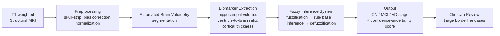

# FADE - Fuzzy-Assisted Diagnostic Evaluator for Dementia Staging

*A Volumetric MRI Decision-Support Tool to Reduce Diagnostic Workload in Clinical Neurology*

| Name | Reg. No. |
|---|---|
| Aryaditya Deshmukh | 23BCE5056 |
| Purusharth Kumar | 23BCE1908 |
| Punya K Sirohi | 23BCE1917 |

---

## 1. Project Domain

Medical Image Analysis and Computational Intelligence - applying fuzzy logic and soft-computing
techniques to volumetric neuroimaging (structural MRI) for automated staging of Alzheimer's disease
(AD) and related dementias. The project sits at the intersection of:

- Biomedical image processing (MRI preprocessing, segmentation, volumetry)
- Uncertainty-aware machine learning (fuzzy inference vs. hard-label classifiers)
- Clinical decision support (workflow integration, not just algorithmic accuracy)

## 2. Problem Statement

Dementia progresses along a continuum - **Cognitively Normal (CN) → Mild Cognitive Impairment (MCI)
→ Alzheimer's Disease (AD)** - that is genuinely hard to separate from structural MRI alone, especially
in early or borderline cases. Today:

- Neurologists manually estimate volumetric change across a growing patient load - slow and
  cognitively demanding.
- Conventional automated classifiers emit a single **hard label**, hiding the diagnostic uncertainty
  that actually matters when a biomarker (e.g. hippocampal volume) sits between "normal" and
  "atrophied."
- Prior fuzzy-logic AD-staging work has been validated almost exclusively on public benchmarks
  (ADNI, OASIS) and rarely tested against **heterogeneous real clinical scans**, and rarely designed
  around day-to-day clinical workflow.

**FADE's proposition:** extract volumetric biomarkers from T1-weighted structural MRI, pass them
through a fuzzy inference system that outputs a **dementia stage + a confidence/uncertainty score**
(not just a label), and use that score to triage - so a neurologist spends review time on genuinely
uncertain cases instead of re-examining every scan from scratch. The goal is workload *reduction*,
not workload *replacement*.

## 3. Proposed Pipeline



**Why fuzzy logic, specifically:** biomarkers like hippocampal volume don't have a hard cutoff between
"normal" and "atrophied" - they degrade continuously and overlap across stages. A fuzzy inference
system (FIS) models that overlap natively via membership functions, rather than forcing a threshold a
hard classifier would need. The rule base is where clinical domain expertise gets encoded directly
(see §5), which is also what keeps the system interpretable to a neurologist, unlike a black-box
CNN.

## 4. Key Differentiators

- **Confidence/uncertainty output, not just a label.** Directly enables the "triage" workflow the
  project targets - the whole point is to reduce clinician workload, not just classify.
- **Real clinical data, not benchmark-only.** Validated on anonymized scans from an active neurology
  practice in addition to OASIS/ADNI, addressing the generalization gap left open by prior studies
  (see reference [1]–[4], [7]).
- **Clinician-in-the-loop rule design.** Fuzzy rules are shaped with a practicing neurologist rather
  than tuned purely to benchmark accuracy.

## 5. Clinical Collaboration

The project is being undertaken in direct collaboration with **Dr. Devdutt Deshmukh, MD, DNB**, a
practicing neurologist. His role:

- Guides feature selection and fuzzy rule design from clinical experience.
- Reviews system staging output against real diagnostic judgment.
- Facilitates access to anonymized patient MRI scans for real-world validation, subject to informed
  consent.

This is a hard dependency for Phase 1 (ethics/consent) and Phase 7 (real-world validation) below -
plan around his availability, not just team bandwidth.

## 6. Datasets

| Dataset | Role | Access |
|---|---|---|
| OASIS | Primary public benchmark - train/validate FIS and biomarker pipeline | Open, registration required |
| ADNI | Secondary public benchmark, used "where access permits" | Requires application/approval - apply early, this can take weeks |
| Clinic scans (anonymized) | Real-world validation, generalization test | Via Dr. Deshmukh's clinic, subject to informed consent + anonymization |

## 7. Tech Stack

- **Backend:** built - see [`backend/`](backend/) (FastAPI + async SQLAlchemy 2.0 + Pydantic v2,
  JWT auth, Alembic migrations, SQLite for local dev / Postgres in Docker). A hand-built fuzzy
  inference engine (not `scikit-fuzzy` - see [`backend/README.md`](backend/README.md) for why) with
  10 explicit rules over three independently-fuzzified biomarkers, and Mamdani centroid
  defuzzification for a 0-1 severity score. It handles two kinds of data and keeps them apart:
  - *Synthetic phantom data* (`backend/app/services/synthetic_mri.py`), measured by an in-house
    `nibabel`/`numpy`/`scipy`/`scikit-image` preprocessing and volumetry pipeline. The demo runs on
    this. Phantom cases are labelled `PHANTOM` everywhere.
  - *Real data*, measured by FreeSurfer or FastSurfer and read from their stats files: the OASIS-1
    cohort (import CLI) and anonymised clinic scans (NIfTI or DICOM upload, with a
    de-identification gate). **Real data is ingested, quality-checked and stored, but not yet
    staged:** every fuzzy-set breakpoint lives in a calibration file, the only one that exists was
    fitted to the phantom, and the engine returns an explicit "indeterminate" for real data until
    a real calibration file is supplied. See
    [`docs/REAL_DATA_RUNBOOK.md`](docs/REAL_DATA_RUNBOOK.md).
- **Decision-support UI:** built and wired to the live API - see [`frontend/`](frontend/) (Vite +
  React 19 + TypeScript + Tailwind CSS v4 + Radix/shadcn-style components + Recharts + Framer Motion +
  TanStack Query). Talks to `backend/` over a camelCase JSON REST contract with JWT auth; the frontend
  never computes anything clinical - every fuzzy-logic number it renders (stage, confidence,
  uncertainty, fired rules, membership curves) comes straight from the API. Covered by a vitest + React
  Testing Library suite (`frontend/`'s `npm test`) alongside the backend's pytest suite.
- **Evaluation (Phase 6 interim results completed):** scikit-learn (metrics), pandas, matplotlib, seaborn — preliminary empirical benchmarking executed on OASIS-1 ($N = 235$) in Google Colab (see [`docs/BENCHMARK_OASIS1.md`](docs/BENCHMARK_OASIS1.md) and §9.1 below).

## 8. Repository Structure

```
pjt1/
├── backend/                # ✅ built - FastAPI + fuzzy inference engine + MRI pipeline, see backend/README.md
├── frontend/               # ✅ built - decision-support dashboard, wired to the live API, see frontend/README.md
├── docker-compose.yml      # full stack: Postgres + FastAPI + React (nginx) - see §12 below
├── docs/                   # architecture, real-data runbook, baseline gate, OASIS-1 benchmark
│   ├── ARCHITECTURE.md       # file reference + register of unsourced clinical assumptions (C1-C10)
│   ├── REAL_DATA_RUNBOOK.md  # importing OASIS, processing clinic scans, anonymisation, calibration
│   ├── BENCHMARK_OASIS1.md   # ✅ OASIS-1 empirical benchmark & Mamdani fuzzy triage validation
│   └── PHASE0_GATE.md
├── PHASES.md
└── README.md
```

`backend/`'s and `frontend/`'s own internal layouts are documented in their respective READMEs rather
than duplicated here.

## 9. Project Phases

See [PHASES.md](PHASES.md) for the full phase-by-phase breakdown (goals, tasks, deliverables,
dependencies, and risks per phase).

**Summary:**

| # | Phase | Focus |
|---|---|---|
| 0 | Foundation & Literature Review | Done - 7 papers reviewed, gap identified |
| 1 | Requirements, Ethics & Data Access | IRB/consent, dataset applications - **still open, blocks Phase 7** |
| 2 | Data Acquisition & Preprocessing | **Ingestion built** in [`backend/`](backend/) - OASIS import CLI and anonymised clinic uploads are ready; no real data has been loaded yet. In-house preprocessing remains phantom-only |
| 3 | Volumetric Feature Extraction | **Built for both routes** - phantom: in-house segmentation; real data: FreeSurfer/FastSurfer stats parsed and normalised by ICV. FADE does not segment real scans itself |
| 4 | Fuzzy Inference System Design | **Engine built** - 10 rules, centroid defuzzification, explicit "indeterminate" results, calibration loaded from a file. **No real calibration exists yet**; rules and breakpoints are illustrative, not clinician-reviewed |
| 5 | System Integration | **Built** - phantom: MRI in → stage out; real data: stats or scan in → biomarkers and QC out, staged once a real calibration is installed |
| 6 | Benchmark Validation | **Interim Completed** on OASIS-1 ($N = 235$) — baseline models + fuzzy triage validation (see [`docs/BENCHMARK_OASIS1.md`](docs/BENCHMARK_OASIS1.md)) |
| 7 | Real-World Clinical Validation | **Tooling built, study not run** - blind clinician-rating endpoints and a research export exist; still blocked on Phase 1 (clinic consent/ethics) and on a real calibration |
| 8 | Decision-Support Interface | **Built for the phantom demo** - not yet updated for real data: no login screen (the API now requires one outside demo mode), and it does not yet show indeterminate results or the new scan states |
| 9 | Evaluation & Iteration | Refine rules against clinical feedback |
| 10 | Documentation & Presentation | Final report, demo, paper writeup |

### 9.1 OASIS-1 Empirical Benchmark & Fuzzy Triage Validation (Colab Results)

Preliminary empirical validation was conducted on the **OASIS-1** cross-sectional cohort ($N = 235$ subjects: 135 CN [$57.4\%$], 70 MCI [$29.8\%$], 30 AD [$12.8\%$]) evaluating volumetric features (`nwbv`, `atrophy`, `etiv`):

- **Baseline Classifier Benchmark (80/20 Stratified Split, 47 test subjects):**
  - **Logistic Regression (Balanced):** **61.90% Balanced Accuracy**, **53.91% Macro-F1** (Top performing baseline architecture).
  - **Support Vector Machine (RBF kernel)** & **Random Forest** evaluated as comparative baselines.
- **Experimental Diagnostic Visualizations Generated:**
  1. `01_cohort_distribution.png`: Clinical stage breakdown across CN, MCI, and AD.
  2. `02_biomarker_distributions.png`: Overlapping density plots of `nwbv` and `etiv` by stage, visualizing continuous atrophy gradients.
  3. `03_model_benchmark.png`: Balanced accuracy comparison highlighting Logistic Regression.
  4. `04_confusion_matrix.png`: True vs. predicted confusion matrix demonstrating classification ambiguity concentrated on the MCI boundary.
  5. `05_per_class_metrics.png`: Precision, Recall, and F1-score across stages.
- **Custom Mamdani Fuzzy Inference Engine & Triage Validation:**
  - Evaluated continuous triangular (`trimf`) and trapezoidal (`trapmf`) membership functions on `nwbv` based on cohort quartiles.
  - Confirmed that conventional hard-label classifiers suffer their highest error rate on the borderline MCI group, whereas FADE's fuzzy inference engine natively surfaces this diagnostic uncertainty to triage cases for clinical review.
  - For full execution details, metrics, and figure specifications, see [`docs/BENCHMARK_OASIS1.md`](docs/BENCHMARK_OASIS1.md).

**Immediate next steps:**

1. *ML:* confirm the VBR formula against OAS1_0001_MR1, import the OASIS-1 cohort, and produce the
   first real calibration file. Until that file exists no real case gets a stage. The procedure is
   in [`docs/REAL_DATA_RUNBOOK.md`](docs/REAL_DATA_RUNBOOK.md).
2. *Frontend:* a login screen, and handling for indeterminate results and the new scan states.
3. *Clinical:* the review conversation Phase 4 has always needed (§5). The rule base and the
   breakpoints are still literature-informed guesses rather than something Dr. Deshmukh has looked
   at; the open items are listed as C1-C10 in [`docs/ARCHITECTURE.md`](docs/ARCHITECTURE.md).

## 10. Success Metrics

- **Staging accuracy / agreement** vs. ground-truth labels on OASIS (and ADNI if access is granted).
- **Clinician agreement (e.g. Cohen's κ)** between FADE's stage output and Dr. Deshmukh's independent
  read on the real clinic scans.
- **Uncertainty calibration** - do low-confidence outputs actually correlate with cases the clinician
  finds genuinely borderline? This is the metric that validates the *workload-reduction* claim, not
  just raw accuracy.
- **Qualitative clinician feedback** on whether the tool's triage would plausibly save review time in
  a real clinic.

## 11. Key Risks

| Risk | Mitigation |
|---|---|
| ADNI access delayed/denied | Treat OASIS as primary; apply for ADNI early in Phase 1, don't block on it |
| IRB/consent process for real clinic scans takes longer than expected | Start Phase 1 ethics track in parallel with Phase 2-3 technical work, not after |
| Real clinical scans are heterogeneous (different scanners/protocols vs. OASIS/ADNI) | Build preprocessing/normalization robust to this from the start; treat it as a Phase 2 design constraint, not a Phase 7 surprise |
| Rule base overfits to one clinician's judgment | Cross-check rules against literature ([2],[4]) in addition to Dr. Deshmukh's input |
| MCI class is inherently ambiguous (hardest of the three stages) | Expect and report lower confidence scores here rather than forcing false precision |

## 12. Running It

**Docker (full stack - the fastest path to a working instance):**

```bash
cp .env.example .env   # set SECRET_KEY - the file explains how to generate one
docker compose up --build
```

Brings up Postgres, the API (migrations applied automatically on container start), and the frontend
(a static Vite build served by nginx) - reachable at `http://localhost:5173`, talking to the API at
`http://localhost:8000`. Each half also has its own standalone `Dockerfile` and its own README with
local (non-Docker) setup instructions: [`backend/README.md`](backend/README.md),
[`frontend/README.md`](frontend/README.md).

**Authentication.** The compose file runs the API in production mode, which requires a login token
on every request. The dashboard has no login screen yet, so with the default `.env` it will show
authorisation errors. For a demo on synthetic data, set `ENVIRONMENT=development` in `.env`: the API
then runs in demo mode, where every visitor acts as one shared demo clinician. Never load real
patient data in demo mode.

**Real data** (the OASIS cohort, clinic scans) is handled through the API and command-line tools
described in [`docs/REAL_DATA_RUNBOOK.md`](docs/REAL_DATA_RUNBOOK.md), run locally from `backend/`.

## 13. References

Reviewed to establish feasibility, methodology, and novelty:

1. *Diagnosing early stages of Alzheimer's diseases based on volumetric features from MRI using soft
   computing algorithms.* Multimedia Tools and Applications, Springer Nature (2025).
   https://link.springer.com/article/10.1007/s11042-025-20732-2
2. *Application of fuzzy logic for Alzheimer's disease diagnosis.* ResearchGate (2015).
   https://www.researchgate.net/publication/285228407_Application_of_fuzzy_logic_for_Alzheimer's_disease_diagnosis
3. *A novel CNN–fuzzy–XAI approach for Alzheimer's disease severity classification using brain MRI
   scans.* Cogent Engineering, Taylor & Francis (2025).
   https://www.tandfonline.com/doi/full/10.1080/23311916.2025.2575105
4. *A fuzzy-based system reveals Alzheimer's Disease onset in subjects with Mild Cognitive
   Impairment.* PubMed. https://pubmed.ncbi.nlm.nih.gov/28610695/
5. *Integrating Demographics and Imaging Features for Various Stages of Dementia Classification: Feed
   Forward Neural Network Multi-Class Approach.* PMC.
   https://www.ncbi.nlm.nih.gov/pmc/articles/PMC11047992/
6. *3D MRI-Based Alzheimer's Disease Classification Using Multi-Modal 3D CNN with Leakage-Aware
   Subject-Level Evaluation.* arXiv (2026). https://arxiv.org/pdf/2603.17304
7. *Computer-Aided Diagnosis System of Alzheimer's Disease Based on Multimodal Fusion: Tissue
   Quantification Based on the Hybrid Fuzzy-Genetic-Possibilistic Model and Discriminative
   Classification Based on the SVDD Model.* PMC. https://www.ncbi.nlm.nih.gov/pmc/articles/PMC6826987/

## 14. Note on Data Ethics

This project involves real, identifiable patient MRI data prior to anonymization. Do not commit any
patient data, DICOM headers, or clinic records to this repository at any point - `data/` should stay
gitignored, and only de-identified, consented, processed data should ever leave the clinical
environment.

What must be done to a scan before it leaves the clinic, and what the backend does and does not
check on arrival, is set out in section C of
[`docs/REAL_DATA_RUNBOOK.md`](docs/REAL_DATA_RUNBOOK.md). Test fixtures in this repository are
hand-written with invented numbers; no real subject's data is committed.

